# weathrz

A terminal weather app with ASCII animations driven by real-time weather data: a house
and garden under a sky that follows the real sun, moon, wind and rain, with holidays,
aircraft and the odd character passing by.

> **weathrz is a fork of [weathr](https://github.com/Veirt/weathr)** by
> [@Veirt](https://github.com/Veirt), with a custom flavour. The animated scene, the
> weather providers and the base of the code are weathr's work; weathrz adds scenery,
> holidays for 24 countries, a real sun and moon, sky characters and a busier status bar.
> It is not affiliated with or endorsed by the weathr project, so please report weathrz
> bugs here, not upstream. For the original, see
> [Veirt/weathr](https://github.com/Veirt/weathr).

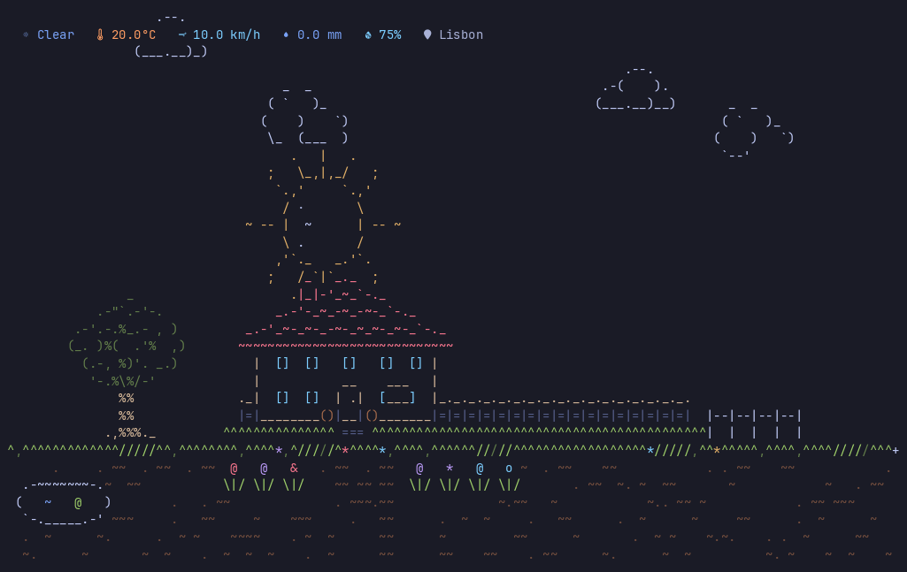

<table>
<tr>
<td width="50%">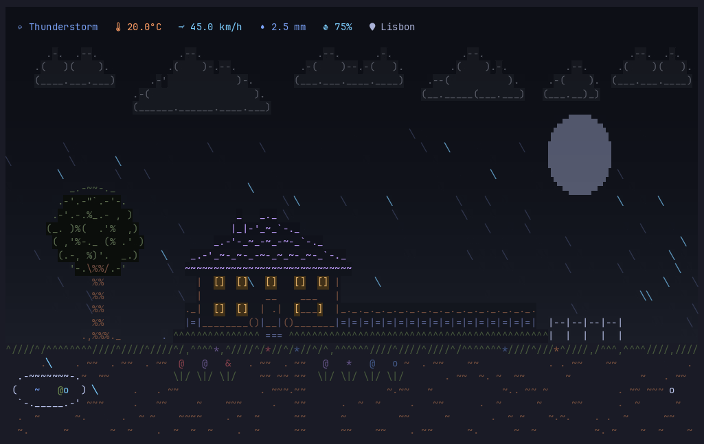<br><sub>Thunderstorm, painted sky · <code>--simulate thunderstorm --night</code></sub></td>
<td width="50%">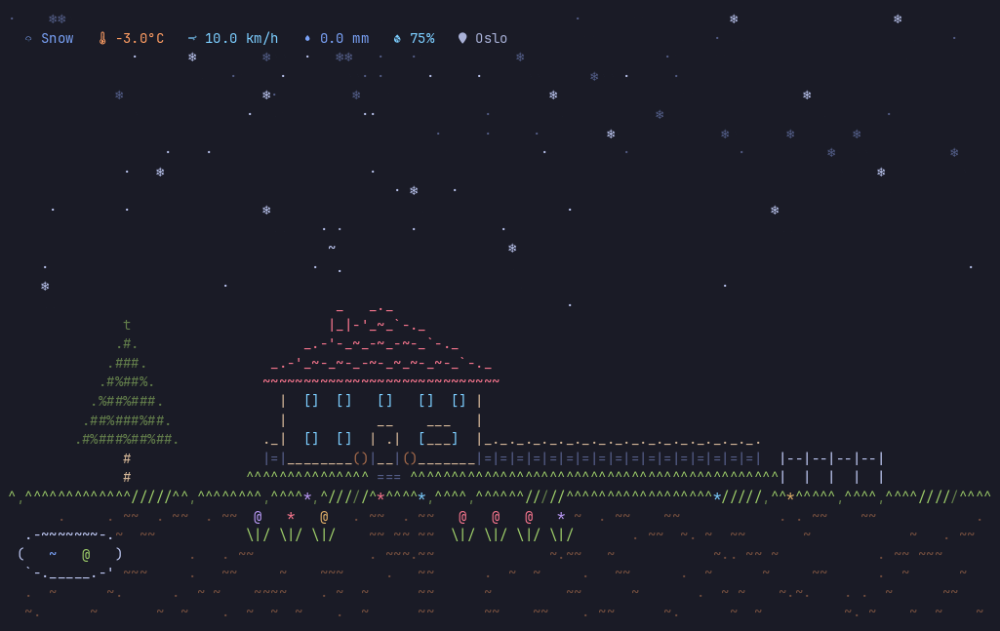<br><sub>Snow in Oslo · <code>--simulate snow</code></sub></td>
</tr>
<tr>
<td width="50%">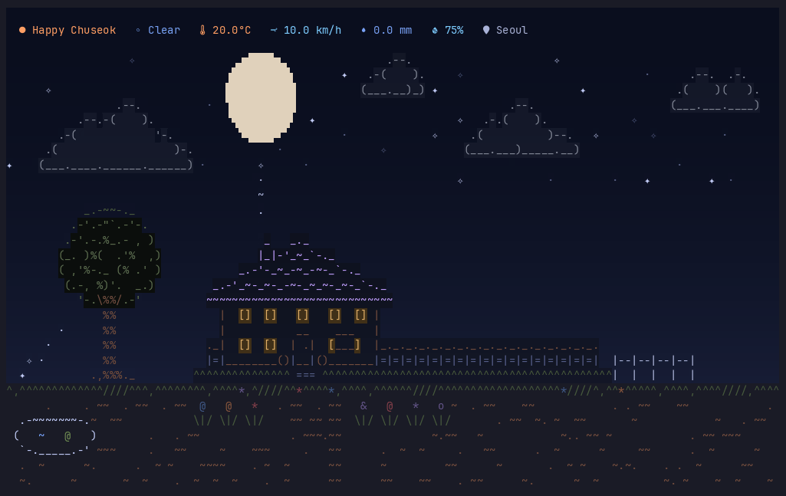<br><sub>Chuseok in Seoul · <code>--event kr:chuseok</code></sub></td>
<td width="50%">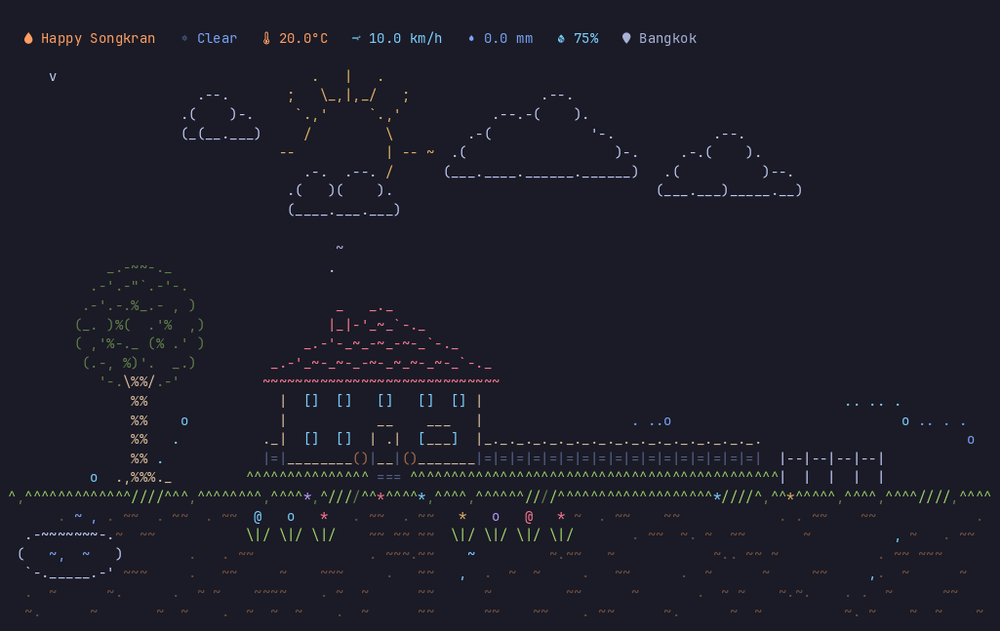<br><sub>Songkran in Bangkok · <code>--event th:songkran</code></sub></td>
</tr>
<tr>
<td width="50%">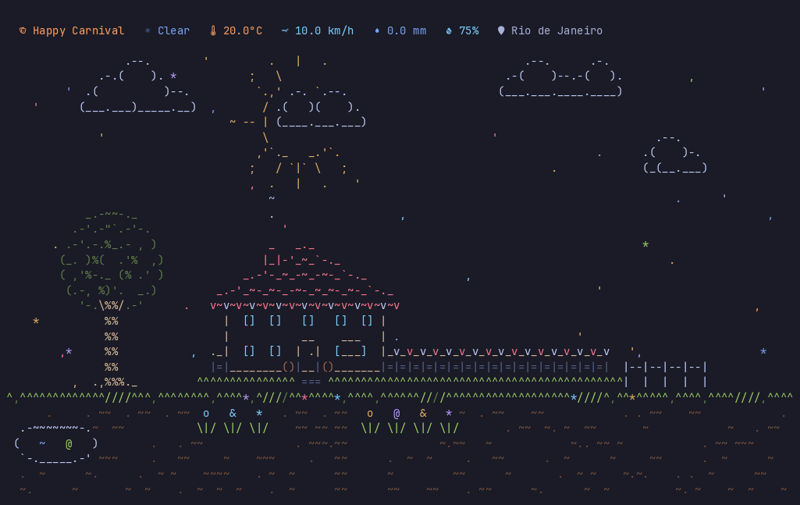<br><sub>Carnival in Rio · <code>--event br:carnival</code></sub></td>
<td width="50%">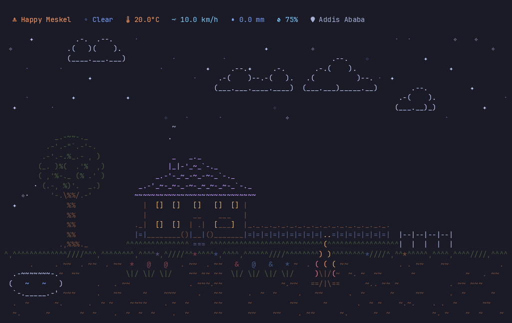<br><sub>Meskel in Addis Ababa · <code>--event et:meskel</code></sub></td>
</tr>
<tr>
<td width="50%">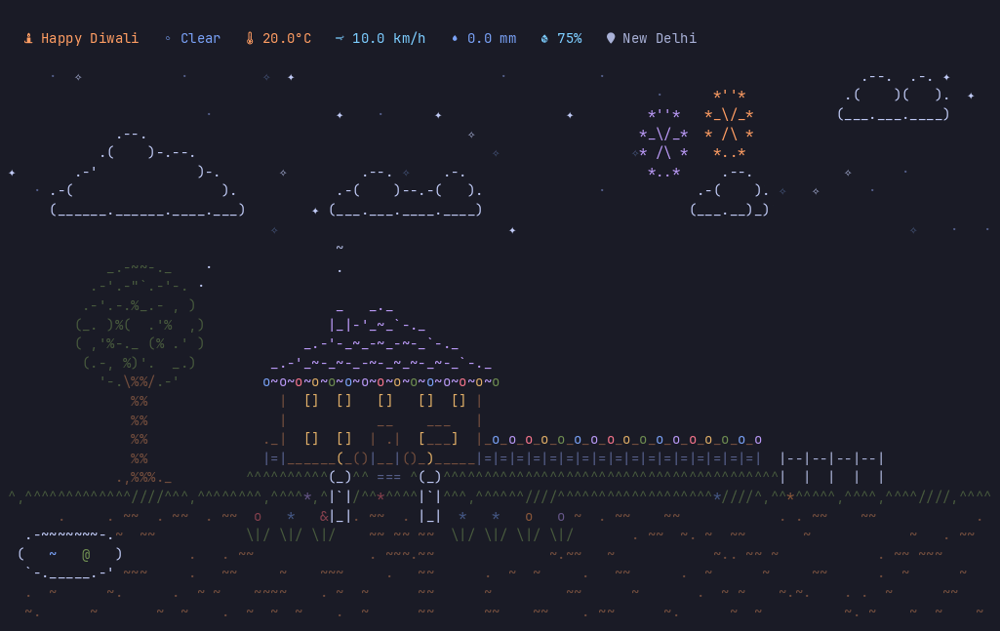<br><sub>Diwali in New Delhi · <code>--event in:diwali</code></sub></td>
<td width="50%">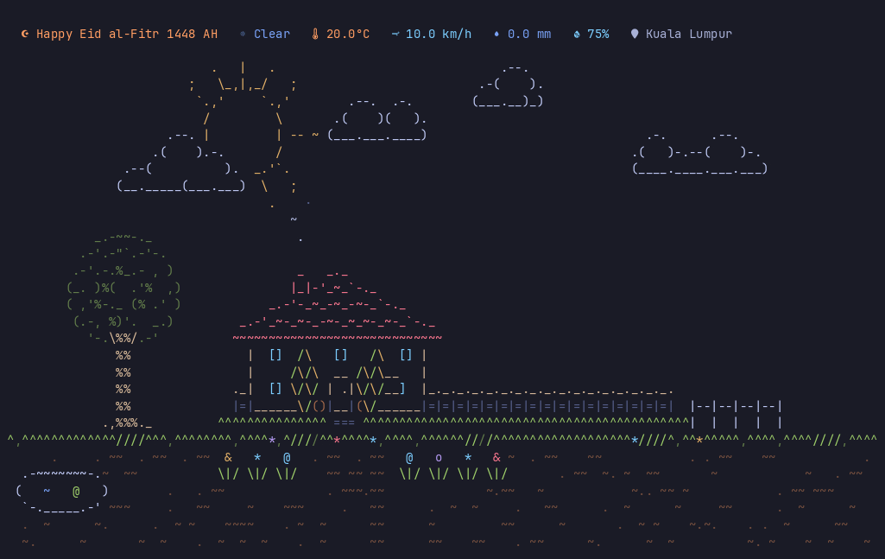<br><sub>Hari Raya in Kuala Lumpur · <code>--event my:eid_al_fitr</code></sub></td>
</tr>
<tr>
<td width="50%">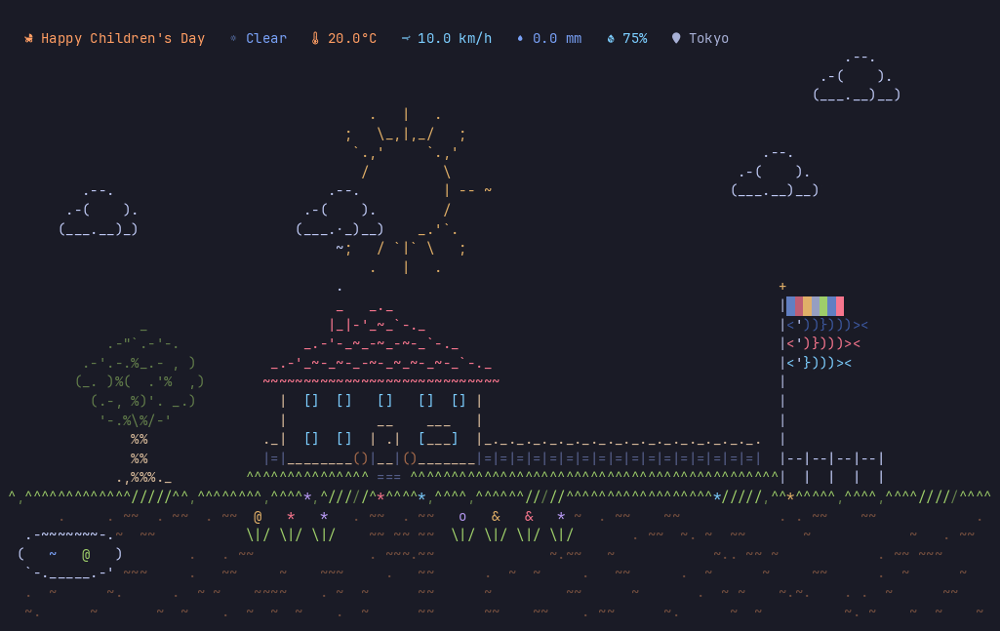<br><sub>Children's Day in Tokyo · <code>--event jp:childrens_day</code></sub></td>
<td width="50%">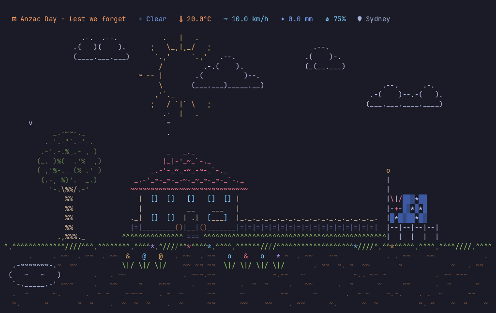<br><sub>Anzac Day in Sydney · <code>--event au:anzac_day_half_mast</code></sub></td>
</tr>
<tr>
<td width="50%">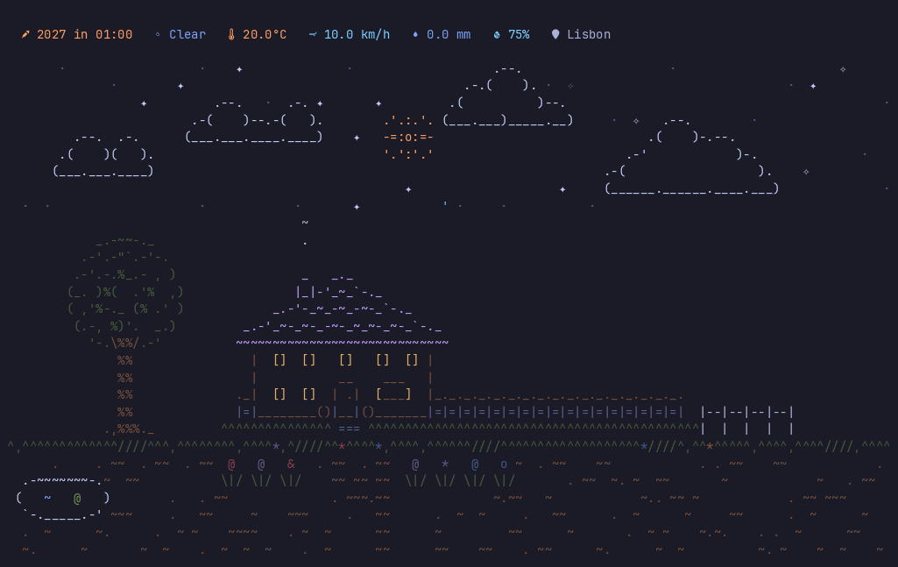<br><sub>New Year's Eve · <code>--event new_year</code></sub></td>
<td width="50%">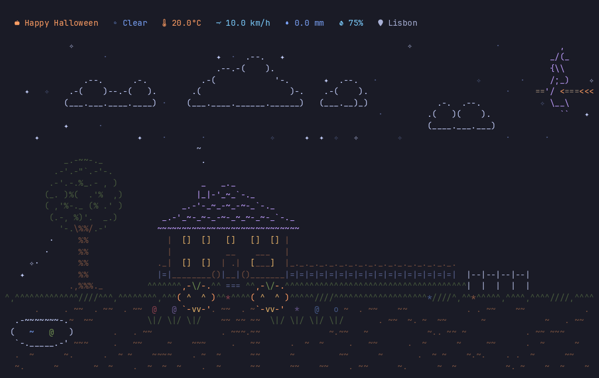<br><sub>Halloween · <code>--event halloween</code></sub></td>
</tr>
</table>

<sub>120 × 32, the Tokyo Night theme and a Nerd Font; recorded with `tools/record_demos.py`.</sub>

## Contents

- [What weathrz adds](#what-weathrz-adds)
- [Installation](#installation)
- [Configuration](#configuration)
- [Usage](#usage)
- [Privacy](#privacy)
- [License](#license)
- [Credits](#credits)

Working on the code (pulling upstream updates, adding a sky character, updating the
holiday tables): [FORK.md](FORK.md).

## What weathrz adds

- Colour themes (`--theme`, `--list-themes`), a Nerd Font status bar (`icons = "nerd"`)
  and `hide = [...]` for scene pieces.
- Seasonal events everywhere (`--date`, `--event`, `--list-events`): Halloween (pumpkins,
  bats, a witch), Christmas (roof lights, tree ornaments, a sleigh) and New Year (a
  countdown, sparkles and fireworks).
- Public holidays for 24 countries, picked from your location's country (`[events]
  country`, `--country`): Australia, Bangladesh, Brazil, China, Egypt, Ethiopia, France,
  Germany, India, Indonesia, Japan, Malaysia, Mexico, Nigeria, Pakistan, the Philippines,
  Russia, Singapore, South Korea, Thailand, Türkiye, the United Kingdom, the United States
  and Vietnam, plus each country's best-known observances and its days of mourning.
  Each country's flag flies on its national days, with Diwali lights, Holi colour and the
  Holika Dahan bonfire, Lunar New Year lampions, a gold harvest moon at Chuseok and
  Mid-Autumn, Songkran water, Carnival confetti, Philippine parols, ketupat at Eid,
  koinobori on Children's Day, the Meskel bonfire, Fourth of July and Bonfire Night
  fireworks, Easter eggs and festival candles. Greetings count each country's years
  (the Hijri year, a national day's anniversary, the zodiac year), and Islamic days begin
  at the real sunset.
- `events.toml`: your own days (with a look, an icon and `{since YYYY}`) and moved
  holidays, for when your community's date differs from the bundled one.
- Trees chosen by climate (shade and fruit trees, firs, saguaros) whose crowns sway with
  the real wind; clouds drift with it too; grass leans in travelling gusts. A pond and
  two flower beds in the front yard.
- A real sun and moon: they rise and set at their own times for your location, and the
  moon's terminator is cut at the angle you see it (a boat near the equator).
- Rain in two depths: far rain falls behind the house and splashes on the roof and the
  grass line, near rain falls in front and puddles across the yard, and heavy rain
  sweeps through in sheets. Lightning grows down the sky over a few frames and
  often flickers twice. An optional painted sky (`[sky] painted = true`) sits behind it all.
- A Unicode sky by default (box-line rain, ✦ stars, ❄ snow, ░ fog, solid flags and a
  block-drawn moon; `glyphs = "fine"` draws the moon in sextants, `"ascii"` turns it all
  off); correct 256- and 16-colour
  fallbacks; synchronized frames.
- The bar shows the next likely rain ("rain ~13:00 · 69%"), feels-like when it differs,
  UV by day, humidity and US air quality; `[location] name` / `--location` take a place
  name; `--locate`, `--where`; `?` help, `i` details and `r` refresh keys; `--line`
  prints the bar once for status bars and `--json` the reading for scripts.
- An in-app offer to switch when your IP location is far from the configured one
  (`[location] ip_check`).
- Honest offline mode (the last reading with its age, quick retries), any pane size, and
  a lower frame rate when the terminal loses focus (`fps`, `idle_fps`).
- A rotation of 15 aircraft, 9 characters and a windy-day kite (`[sky]`, `--flyer`,
  `--list-flyers`).
- Everything in English, greetings included, behind a `language = "en"` setting.
- Clean exit on Ctrl-C, SIGTERM and SIGHUP.

## Installation

weathrz builds from source. It installs as `weathrz`, so it sits beside an installed
`weathr` without replacing it.

You need Rust 1.85 or newer ([rustup](https://rustup.rs/)) and a C toolchain with
`cmake` (the TLS crate, `aws-lc-sys`, compiles C code): for example
`sudo apt install build-essential cmake` or `sudo dnf install gcc gcc-c++ make cmake`.

```bash
cargo install --git https://github.com/dilettantemode/weathrz --locked --bin weathrz
```

or from a clone:

```bash
git clone https://github.com/dilettantemode/weathrz.git
cd weathrz
cargo install --path . --locked --bin weathrz
```

(`--bin weathrz` leaves out `generate-manpage`, a build helper you don't need on your PATH.)

`cargo test --locked` runs the test suite. For the Nerd Font icons in the bar, install
a [Nerd Font](https://www.nerdfonts.com/font-downloads) and pick it in your terminal;
without one, set `icons = "ascii"` (and `glyphs = "ascii"` if the sky shows boxes).

## Configuration

The config file location depends on your platform:

- **Linux**: `~/.config/weathrz/config.toml` (or `$XDG_CONFIG_HOME/weathrz/config.toml`)
- **macOS**: `~/Library/Application Support/weathrz/config.toml`
- **Windows**: `~/AppData/Roaming/weathrz/config.toml`

Until that file exists, weathrz reads weathr's config folder (`.../weathr/config.toml`,
with its `events.toml` and `themes/`), so an existing weathr setup works as it is.
`config.example.toml` is a short starting point:

```bash
mkdir -p ~/.config/weathrz
cp config.example.toml ~/.config/weathrz/config.toml
```

Every option, with its default:

```toml
# Hide the HUD (Heads Up Display) with weather details
hide_hud = false

# Run silently without startup messages (errors still shown)
silent = false

# Trees beside the house: "auto" picks them from the latitude (a round shade tree and a
# fruit tree up to 55°, firs above); or force "tropical", "temperate", "cold" or "dry"
# (saguaro cacti). Temperate trees lose their leaves below freezing, and every tree's
# crown sways with the wind.
trees = "auto"

# Frames per second while the terminal has focus (5-30), and while it doesn't (5-30, or
# 0 to keep the focused rate). Rates round to 30, 15, 10, 7.5, 6 or 5. Motion keeps its
# speed either way: at the idle rate the scene only draws less often. Needs a terminal
# that reports focus changes.
fps = 30
idle_fps = 5

# Glyphs for the sky: "unicode" (default) — box-line rain (│ ╎ ╱ ╲), stars ✦ ✧ ·,
# snow ❄ ·, fog ░, solid flag cloth with half-block stripes, a block-drawn moon and,
# with a painted sky, two colour bands per row — or "fine" for all that plus a moon in
# sextants (2×3 per cell; Windows Terminal, kitty, WezTerm and foot draw them) — or
# "ascii" for a font without those characters. The house and garden are ASCII always.
glyphs = "unicode"

# The language of everything weathrz writes: the bar, the help box and every holiday
# greeting. "en" is the only one so far (the default); anything else warns.
language = "en"

[location]
# A place name instead of coordinates: geocoded once through Open-Meteo and cached.
# Narrow it with a region (in English or the local language) or a two-letter country
# code: "Springfield, Illinois", "Valencia, VE". A two-letter state code reads as a
# country, so write the state's name. `weathrz --locate Springfield` lists the matches.
# Coordinates in WEATHR_LATITUDE / WEATHR_LONGITUDE still win. The bar shows the name
# when display is "city" or "mixed". A named place also brings its country for the
# holidays (unless [events] country is set).
# name = "Lisbon"

# Location coordinates (overridden if auto = true)
latitude = 52.5200
longitude = 13.4050

# Auto-detect location via IP (defaults to true if config missing)
auto = false

# With auto = false: look up your IP location in the background at startup and,
# if it is more than 100 km from the coordinates above, offer to switch for this
# run ([i] use IP location, [c] keep config; the offer disappears after 30 s).
# Makes one request to ipinfo.io per start. Off when hide = true.
ip_check = false

# Hide the location name in the UI
hide = false

# How to display the location in the HUD: "coordinates" | "city" | "mixed"
display = "mixed"

# Optional: manually override the city name shown in the HUD.
# When set, skips reverse geocoding entirely.
# city = "Berlin"

# Language for the resolved city name: "en" (default), "auto" for the place's own
# language, or a BCP-47 tag such as "de" or "ja".
# city_name_language = "en"

[units]
# Temperature unit: "celsius" or "fahrenheit"
temperature = "celsius"

# Wind speed unit: "kmh", "ms", "mph", or "kn"
wind_speed = "kmh"

# Precipitation unit: "mm" or "inch"
precipitation = "mm"
```

### Location Display Modes

The `display` option controls how the location appears in the HUD. City names are resolved
via reverse geocoding (Nominatim/OpenStreetMap). When a city cannot be resolved (e.g. open
sea or no Nominatim match), all modes fall back to showing coordinates.

| Mode          | City resolved                         | City not resolved            |
| :------------ | :------------------------------------ | :--------------------------- |
| `coordinates` | `Location: 52.52°N, 13.41°E`          | `Location: 52.52°N, 13.41°E` |
| `city`        | `Location: Berlin`                    | `Location: 52.52°N, 13.41°E` |
| `mixed`       | `Location: Berlin (52.52°N, 13.41°E)` | `Location: 52.52°N, 13.41°E` |

### Example Locations

```toml
# Tokyo, Japan
latitude = 35.6762
longitude = 139.6503

# Sydney, Australia
latitude = -33.8688
longitude = 151.2093
```

## Usage

Run with real-time weather:

```bash
weathrz
```

### CLI Options

Simulate weather conditions for testing:

```bash
# Simulate rain
weathrz --simulate rain

# Simulate snow at night
weathrz --simulate snow --night

# Clear day with falling leaves
weathrz --simulate clear --leaves
```

Available weather conditions:

- Clear Skies: `clear`, `partly-cloudy`, `cloudy`, `overcast`
- Precipitation: `fog`, `drizzle`, `rain`, `freezing-rain`, `rain-showers`
- Snow: `snow`, `snow-grains`, `snow-showers`
- Storms: `thunderstorm`, `thunderstorm-hail`

Seasonal events can be previewed or listed. Four yearly ones show everywhere and greet in
the same English words everywhere:

| Event | When | What you see |
|---|---|---|
| `halloween` | 31 Oct → 1 Nov 06:00 | pumpkins by the door, bats and a witch at night, "Happy Halloween" |
| `christmas_lights` | 15 → 26 Dec | lights on the eave and veranda (unlit by day, twinkling at night), ornaments on the trees |
| `christmas` | 24 → 26 Dec | "Merry Christmas" (not in Russia, Ethiopia or Egypt, which keep 7 January, nor in Türkiye); a sleigh and reindeer cross the sky on Christmas Eve night (19:00–05:00) |
| `new_year` | 31 Dec 20:00 → 1 Jan | a countdown ("2027 in 00:12"), sparkles from 20:00, fireworks 23:00–01:00, then "Happy New Year 2027" |

### Holidays by country

Each country's own public holidays show where you are. weathrz takes the country of the
configured location from the nearest of about 1,000 capitals and large cities
(`src/events/assets/places.txt`, offline, within 1,200 km). Near a border, or to see
another country, set it yourself:

```toml
[events]
country = "auto"        # or a code below, or "none" for the yearly events only
```

| Code | Country | Days off | Observances | Decorations |
|---|---|---|---|---|
| `AU` | Australia | 5 | 7 | the flag and fireworks on Australia Day, the flag at half-mast on Anzac morning, Easter eggs, candles on Remembrance Day |
| `BD` | Bangladesh | 18 | 4 | the flag on Independence and Victory Day, at half-mast on 21 February and 14 December; the crescent for Ramadan and both Eids, candles on Shab-e-Barat and Buddha Purnima |
| `BR` | Brazil | 10 | 7 | the flag on Independence Day, Carnival confetti and bunting, a Festa Junina bonfire, Easter eggs, candles on Finados |
| `CN` | China | 7 | 9 | the flag on National Day; lampions for the Spring Festival (fireworks on New Year's Eve); lanterns and a gold harvest moon at Mid-Autumn |
| `DE` | Germany | 7 | 9 | the flag on German Unity Day and at half-mast on three days of remembrance, Carnival confetti on Rosenmontag, St Martin's lanterns, an Advent wreath and candles, Christmas Eve candles, Easter eggs |
| `EG` | Egypt | 13 | 3 | the flag on its national days, the crescent for Ramadan and both Eids, Easter eggs for Sham el-Nessim, Christmas lights through Coptic Christmas on 7 January and its candles |
| `ET` | Ethiopia | 12 | 4 | the flag on Adwa and Patriots' Victory Day; the Demera bonfire on Meskel eve; candles at Genna and Fasika, the crescent on both Eids |
| `FR` | France | 9 | 5 | the flag and fireworks on Bastille Day, the flag on VE Day and Armistice Day, Mardi Gras confetti, Easter eggs |
| `IN` | India | 21 | 8 | the flag on Republic and Independence Day; kites on Makar Sankranti; a Holika Dahan bonfire on Holi eve and colour thrown across the yard on Holi; Diwali lights, lamps and fireworks; Dussehra fireworks; candles on Vesak and Guru Nanak Jayanti; the crescent on both Eids |
| `ID` | Indonesia | 13 | 13 | the flag at half-mast on 30 September; the flag and bunting all August and a kite on Independence Day; lampions and fireworks at Chinese New Year; a Ramadan crescent, holiday traffic before Eid, takbiran torches and ketupat at both Eids; a silent Nyepi; Vesak candles and sky lanterns; Easter eggs |
| `JP` | Japan | 15 | 6 | koinobori carp streamers on Kodomo no Hi; the Hinomaru on Foundation Day and the Emperor's Birthday, at half-mast on 15 August; greetings for the rest |
| `KR` | South Korea | 12 | 7 | Seollal lampions, the Taegukgi on its national days and at half-mast on Memorial Day, Buddha's Birthday lanterns, a Daeboreum bonfire, a gold harvest moon on Chuseok |
| `MY` | Malaysia | 12 | 6 | the Jalur Gemilang on Merdeka and Malaysia Day; lampions at Chinese New Year, ketupat at Hari Raya, Deepavali lights, the crescent for Ramadan |
| `MX` | Mexico | 5 | 18 | the flag and fireworks for El Grito, at half-mast on nine *días de media asta*, candles on Día de Muertos |
| `NG` | Nigeria | 9 | 4 | the flag on Independence Day; the crescent on both Eids and Mawlid ("Barka da Sallah") |
| `PH` | Philippines | 18 | 7 | the flag on its heroes' and national days, parol star lanterns and Christmas lights from 1 December to Three Kings, candles on All Saints' and All Souls', the crescent for Ramadan and both Eids, Chinese New Year lampions |
| `PK` | Pakistan | 12 | 4 | the flag on Pakistan Day and Independence Day; the crescent for Ramadan and both Eids |
| `RU` | Russia | 8 | 9 | the flag on Russia Day and Unity Day, at half-mast on 22 June; fireworks for the New Year holidays and Victory Day; Christmas lights through Orthodox Christmas on 7 January and its candles |
| `SG` | Singapore | 8 | 6 | the flag and fireworks on National Day, lampions at Chinese New Year, lanterns and a gold harvest moon at Mid-Autumn, ketupat at Hari Raya, Deepavali lights, Vesak candles |
| `TH` | Thailand | 17 | 5 | candles on the Buddhist days, water arcs and splashes at Songkran, the flag on the King's birthday and national days, Loy Krathong lanterns, Chinese New Year lampions |
| `TR` | Türkiye | 8 | 6 | the flag on its national days and fireworks for Republic Day, at half-mast on 10 November, the crescent for Ramadan and both bayrams, New Year lights from 15 December |
| `GB` (or `UK`) | United Kingdom | 6 | 11 | a bonfire and fireworks on Bonfire Night, Easter eggs |
| `US` | United States | 9 | 11 | the flag and fireworks on the Fourth of July, at half-mast on five days of remembrance, Easter eggs |
| `VN` | Vietnam | 6 | 6 | Tết lampions, the flag and fireworks on National Day, Vesak lanterns, lanterns and a gold harvest moon at Mid-Autumn |

Observances are days most people in a country would recognise that are not days off:
Mother's Day, Hari Kartini, Pepero Day, Remembrance Sunday. They greet like holidays but
give way to a day off on the same date; `[events] observances = false` hides them all.
On days of mourning set by law or protocol (Indonesia's 30 September, US Memorial Day
until noon, Atatürk's 10 November, Germany's Volkstrauertag, Mexico's best-known *días de
media asta*) the flag flies at half-mast, two rows down the pole.

Flags fly from a pole by the garden fence, ripple with the wind and stream downwind of
the pole; in calm air (under 3 km/h) they hang limp beside it, and the koinobori carp
hang head up. Bonfires burn in the front yard after dark: on
the eve for Meskel and Holika Dahan, from 17:00 on Bonfire Night; rain puts them out.

Event ids carry the country: `in:diwali`, `us:thanksgiving`, `jp:childrens_day`. A bare
name also works in `--event` and `disable` (`diwali`, `boxing_day`): it means your country's
day, or every country's for `disable`. Egypt, Ethiopia and Russia keep their own Christmas
on 7 January and Türkiye marks the New Year instead, so the yearly Christmas greeting
stays away there (Ethiopia also skips 1 January). Days that
follow the moon or an announcement are bundled for 2026 to 2028 from the governments'
lists (sources are in `docs/holidays/` and at the end of `--list-events`); fixed and
rule-based days (nth weekday, Easter, Orthodox Easter, Japan's equinoxes) are computed
for any year. Unpublished or moon-sighted dates are marked tentative: no country has
published its 2028 list yet (checked 21 Oct 2026), so every 2028 moon or announcement
date is an estimate. For 20 years after the tables, the moon days are calculated
(tentative): the Islamic days by one crescent rule for every country (neo-MABIMS, seen
from Banda Aceh), used only where it matches that country's bundled dates within a day,
so a country that follows its own sighting can differ by a day; the lunisolar calendar
with its leap months, reckoned on each country's own clock (Beijing for China and its
neighbours, UTC+9 for Korea and Japan, UTC+7 for Vietnam, so Korea's Seollal can fall a
day after China's; checked against the Hong Kong Observatory through 2040) for Lunar New
Year, Seollal, Tết, the Lantern Festival, Daeboreum, Qixi, the Hungry Ghost Festival,
Chuseok and Mid-Autumn, Double Ninth, the Dragon Boat and Buddha's Birthday; the solar
terms for Qingming, the winter solstice (Dongji) and Setsubun; and Nyepi and Vesak, each
keeping its country's usual shape (eves, bridge days, a day of lag). A move in `events.toml` changes only its own year. Hindu festivals and announced days go quiet until their
tables are updated. Greetings are in English: "Happy …" for celebrations, the plain
name for solemn days. Christmas and New Year's Day come from the yearly events.

### How the holidays look

| Look | Where you see it |
|---|---|
| The flag by the fence, at half-mast on days of mourning | every country's national days; half-mast in Australia, Bangladesh, Germany, Indonesia, Japan, Mexico, Russia, South Korea, Türkiye and the US |
| Lampions by the door | Lunar New Year in China, Indonesia, Malaysia, the Philippines, Singapore, South Korea, Thailand and Vietnam |
| Paper lanterns | Mid-Autumn (China, Singapore, Vietnam), Buddha's Birthday (South Korea), Loy Krathong (Thailand), St Martin's Day (Germany), Obon (Japan) |
| A gold harvest moon | Chuseok and Mid-Autumn nights in China, Singapore, South Korea and Vietnam |
| The crescent and star | Ramadan and both Eids in Bangladesh, Egypt, Ethiopia, India, Indonesia, Malaysia, Nigeria, Pakistan, the Philippines, Singapore and Türkiye |
| Ketupat by the door | Eid in Indonesia, Malaysia and Singapore |
| Candles | Vesak, All Souls, Día de Muertos, Genna, Advent, Remembrance and other days of light in 16 countries |
| Lights along the eave, lamps and fireworks | Diwali in India, Malaysia and Singapore |
| Christmas lights | each country's own season: the Philippines from 1 December to Three Kings, Egypt and Russia through Christmas on 7 January, Türkiye as New Year lights, 15–26 December elsewhere (none in Ethiopia) |
| Parol star lanterns | the Philippines' Christmas season |
| A wreath under the eave | German Advent Sundays |
| A bonfire after dark | Meskel eve (Ethiopia), Holika Dahan (India), Bonfire Night (UK), Daeboreum (South Korea), Festa Junina (Brazil) |
| Colour thrown across the yard | Holi (India) |
| Water arcs and splashes | Songkran (Thailand) |
| Confetti and bunting | Carnival in Brazil, Germany and France; bunting all August in Indonesia |
| A kite up all day | Indonesia's Independence Day (red and white), Makar Sankranti in India |
| Koinobori carp streamers | Children's Day (Japan) |
| Fireworks and sparkles | New Year's Eve everywhere; Lunar New Year's Eve wherever it is kept; national or festival nights in Australia, France, India, Mexico, Russia, Singapore, Türkiye, the UK, the US and Vietnam; takbiran night in Indonesia |
| Easter eggs in the grass | Easter in Australia, Brazil, Egypt, France, Germany, Indonesia, Russia, the UK and the US |
| Holiday traffic, takbiran torches, a silent day | Indonesia: the mudik week before Eid, takbiran night, Nyepi |
| Pumpkins, bats and a witch | Halloween, everywhere |

Greetings count the years the way each country does: the Hijri year on Islamic days
("Happy Eid al-Fitr 1448 AH"), the anniversary of a national day ("Happy 80th
Independence Day, India", "America's 250th birthday"), the zodiac year at Lunar New Year
(Vietnam's cat where others have the rabbit), and Indonesia's Saka, Buddhist and Chinese
years. Islamic days, and the end of Ramadan, begin at the real sunset at your location;
`--list-events` prints 18:00 as a stand-in.

How the tables are kept up to date is in [FORK.md](FORK.md). When days
with greetings overlap, the bar takes turns every 10 seconds, in this order: your own
days, the New Year countdown, then the country's own days (the shorter or moon-dated one
first), then Halloween and Christmas. An observance greets
only when no day off of the country does. Decorations of all of them show together, so a
half-mast flag still flies on US Memorial Day morning under the holiday's greeting. Long greetings shorten to the part before the dot when the bar is
narrow.

Events decorate but never change the weather: the sleigh, fireworks and lanterns stay
away in rain, snow, storms and fog, and rain puts out the torches.

```bash
# Halloween night at its showcase time (21:00)
weathrz --event halloween

# New Year's Eve at 23:00, during the fireworks
weathrz --event new_year

# Diwali night in India, or Children's Day in Japan
weathrz --event in:diwali
weathrz --event jp:childrens_day

# Pretend it is another local date/time; the sky follows it, the weather stays live
weathrz --date 2026-10-31T17:55

# Next date of every event for your country, or for another one
weathrz --list-events
weathrz --list-events --country jp
```

### Your own days and moved holidays

`~/.config/weathrz/events.toml` (next to `config.toml`) adds your own days and moves a
bundled holiday that follows the moon or an announcement, for example when your
community sights the new moon a day later than the bundled date. `events.example.toml`
has every option.

```toml
[[move]]
event = "pk:eid_al_fitr" # an id from --list-events
year = 2027              # or from = "2027-03-10", any day inside it
shift = 1                # or to = "2027-03-11", the new first day

[[day]]
name = "Mum's birthday"            # becomes the id "mums_birthday"
date = "03-14"                     # every year; "2027-03-14" for once
greeting = "Happy birthday, Mum · {since 1960}"   # {since YYYY} = years since then
look = "candles+bunting"           # flag, bunting, kites, bonfire, holi, koinobori, songkran,
                                   # harvest_moon, carnival, parol, wreath, fireworks, lanterns,
                                   # lights, candles, sky_lanterns, ketupat, eggs, torches,
                                   # pumpkins, calm
icon = "cake"                      # cake, gift, heart, party, star, flag, fire, flower
```

Moving Eid al-Fitr (`pk:eid_al_fitr`, `my:eid_al_fitr`, `id:idulfitri`…) also moves the
end of that year's Ramadan and, in Indonesia, the mudik week. Your own days greet first when days overlap
(the bar takes turns every 10 seconds), and their ids work in
`[events] disable`. A name can't reuse a holiday's name (`ramadan`). Mistakes show as
warnings at start, and the rest of the file still loads.

Turn them off in `config.toml`:

```toml
[events]
enabled = true          # false turns every event off
observances = true      # false keeps the days off and hides the observances
disable = []            # e.g. ["halloween", "gb:bonfire_night"]
country = "auto"
```

Override configuration:

```bash
# Use imperial units (°F, mph, inch)
weathrz --imperial

# Use metric units (°C, km/h, mm) - default
weathrz --metric

# Auto-detect location via IP
weathrz --auto-location

# Hide location coordinates
weathrz --hide-location

# Hide status HUD
weathrz --hide-hud

# Run silently (suppress non-error output)
weathrz --silent

# Combine flags
weathrz --imperial --auto-location

# Use a place for one run (a name, "name, region", "name, CC" or "LAT,LON")
weathrz --location "Springfield, Illinois"
weathrz --location=-33.9,18.4

# List the places that match a name, or show the place in use and where it came from
weathrz --locate Springfield
weathrz --where

# Print the bar once as a single line and exit (for tmux, zellij or a status bar)
weathrz --line

# Print the reading as JSON and exit (metric keys such as temperature_c and wind_kmh)
weathrz --json
```

`--line` reuses a reading under 10 minutes old, otherwise fetches once (8 s limit) and
falls back to the last saved reading with its age. With `--simulate` (and `--night`) it
prints the simulated weather instead, without fetching. For zjstatus:

```kdl
command_weather_command  "weathrz --line"
command_weather_interval "300"
```

The bar shows what matters right now. When it is dry, the precipitation amount gives way
to the first hour in the next 12 with a 50 % chance of rain ("rain ~13:00 · 69%", "storms"
when thunder follows), and disappears when nothing reaches 50 %; while it rains it says
when the chance drops below 30 % ("· until ~16:00"). The temperature adds "(feels 40°)"
when the apparent temperature is 2 °C or more away, and UV shows by day from 3, coloured
like the AQI bands (moderate, high, very high, extreme). Narrow panes drop UV first.

Flyers (aircraft, characters, and the witch on Halloween nights) and the kite:

```bash
weathrz --list-flyers          # aircraft, characters and the kite, with size, directions and when
weathrz --flyer balloon        # preview one flyer or character: it comes within a second and repeats
weathrz --flyer moon-biker     # rides along the moon's row (best at night, near a full moon)
weathrz --flyer kite           # the kite flyer comes out within a second and stays
```

```toml
[sky]
flyers = []        # empty = all 15 aircraft; or e.g. ["plane", "heli", "balloon"]
characters = []    # empty = all 9: caped-hero ufo moon-biker broom-rider fairy pterosaur flying-car dragon long-dragon
specials = 12      # about one flight in 12 is a character; 0 = no characters
every = "calm"     # calm (2-3 min) | normal (~1 min) | busy (20-40 s) | seconds, e.g. 90
banner = ""        # text towed by the banner plane; empty = your city
painted = false    # true paints the sky behind the scene (truecolor terminals)
```

`painted = true` fills the sky with a gradient that follows the sun: deep navy at night,
purple then amber low down at dusk and dawn, blue by day, greyer under cloud, rain or
fog. Clouds get a lighter body, the house stands as a silhouette in your terminal's own
background, and its windows glow amber after sunset. It is off by default because it
paints over your terminal's background colour; 256- and 16-colour terminals keep the plain
sky, since their palettes turn the dark sky colours grey.

Flyers keep to their hours (`--list-flyers` shows each one): the small planes, the banner
plane, the biplane, the broom rider, the little dragon and the pterosaur fly by day; the UFO, the fairy
and the long dragon at night; the moon biker only on moonlit nights; the airships and the
balloon on calm days; the rest at any time. On windy days (10 km/h or more, by day, and no rain, snow, fog or storm) a kite flyer
comes out on the grass at the right edge for 3–5 minutes about every 20–30 minutes; the
stronger the wind, the higher the kite. Top-level `hide = ["kite"]` turns the kite off;
`hide = ["airplanes"]` hides every flyer, characters included. A hidden piece can't be
previewed either: `--flyer` shows nothing while its system is in `hide`.

Humidity and air quality (US AQI from the Open-Meteo Air Quality API, CAMS model at
about 45 km, so it can differ from street-level stations) show in the bar once the first
readings arrive. Air quality is refreshed hourly and is not fetched under `--simulate`
(use `--aqi` to preview it) or when `hide_hud` is set. The face
icon and colour follow the US bands: good, moderate, sensitive groups, unhealthy, very
unhealthy, hazardous.

```bash
weathrz --aqi 175       # preview a fixed AQI reading (0-500) instead of fetching
```

The sun follows its real path for your location: it rises at the left edge, is highest at
solar noon and sets at the right edge behind the fence. Its height and timing are computed
locally from your coordinates and the clock. In `--date` previews and in offline mode, day
and night follow the real sun too; `--simulate` on its own keeps the sun at its fixed spot
near the top.

The moon follows its real path too: it rises and sets at its own times, is hidden while
it is below the horizon or under 2 % lit, and is cut along the real terminator at the
angle you would see it from your location, so near the equator an evening crescent lies
on its back like a boat. A moon in the northern half of the sky is drawn mirrored, so its
lit side faces where the sun went down on screen. Its dark side hides the stars behind it. `--simulate` on the
real clock keeps the old fixed moon.

The front yard has a pond with a lily pad (rain rings it) and two flower beds by the door,
picked by your location; grass on the ground line leans in gusts that travel downwind.
`hide = ["pond", "flowers"]` removes them.

On 256-colour terminals colours are matched to the nearest palette entry, and on
16-colour ones to the nearest ANSI colour. Frames go out as synchronized updates, so
terminals that support them (Windows Terminal 1.23+, zellij 0.39+) never show a
half-drawn frame.

### Keyboard Controls

- `q` or `Q` - Quit
- `Ctrl+C` - Exit
- `?` - Help: the keys, your location and where it came from, whose holidays apply, the
  config and `events.toml` paths, and the data credits (`Esc` or `?` closes it)
- `i` - Details: wind direction, UV and air-quality bands, sunrise, sunset and where the
  sun stands now, the moon's phase, and the next six hours (`Esc` or `i` closes it)

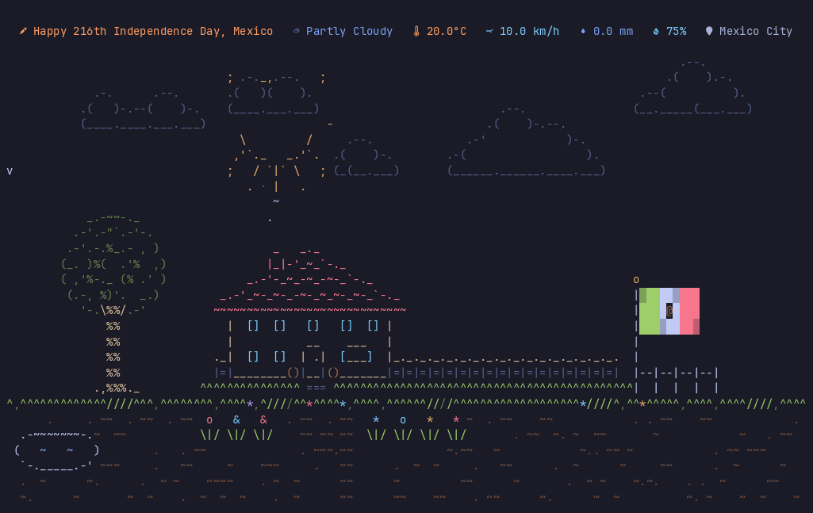

- `r` - Fetch the weather and air quality now

### Environment Variables

The application respects several environment variables:

- `NO_COLOR` - When set, disables all color output (accessibility feature)
- `COLORTERM` - Detects truecolor support (values: "truecolor", "24bit")
- `TERM` - Used for terminal capability detection (e.g., "xterm-256color")

Examples:

```bash
# Disable colors for accessibility
NO_COLOR=1 weathrz
```

## Privacy

### Location Detection

When using `auto = true` in config or the `--auto-location` flag, the application makes a request to `ipinfo.io` to detect your approximate location based on your IP address.

`ip_check = true` makes the same request at every start, even when coordinates are configured.

A place name (`[location] name`, `--location`, `--locate`) is looked up once through the
Open-Meteo geocoding API and cached; city names come from Nominatim (OpenStreetMap).

This is optional. You can disable auto-location and manually specify coordinates in your config file to avoid external API calls.

## License

GPL-3.0-or-later, the same as weathr; see [LICENSE](LICENSE).

weathrz is a modified version of weathr: it was forked from weathr 1.4.0 (upstream commit
`7d403a0`, 12 August 2026) and changed from 9 October 2026 on. The git history keeps
weathr's own commits, with the weathrz changes on top.

The third-party ASCII art credited below belongs to its artists. Each piece keeps its
artist's initials, and it is not covered by this repository's licence.

## Credits

### weathr

The original app: [weathr](https://github.com/Veirt/weathr) by
[@Veirt](https://github.com/Veirt) and its contributors, GPL-3.0-or-later.

### Theme Palettes

The built-in themes take their colours from these projects (each file in
`src/theme/builtin/` names its source): [Catppuccin](https://github.com/catppuccin/palette)
(MIT), [Gruvbox](https://github.com/morhetz/gruvbox) (MIT),
[Kanagawa](https://github.com/rebelot/kanagawa.nvim) (MIT) and
[Tokyo Night](https://github.com/folke/tokyonight.nvim) (Apache-2.0). weathrz is not
affiliated with them.

### Weather Data

Weather data provided by [Open-Meteo.com](https://open-meteo.com/) under the [CC BY 4.0 license](https://creativecommons.org/licenses/by/4.0/).

### Air Quality

Air quality from the [Open-Meteo Air Quality API](https://open-meteo.com/en/docs/air-quality-api)
(Copernicus Atmosphere Monitoring Service model data), under CC BY 4.0.

### Geocoding

City name resolution powered by [Nominatim](https://nominatim.openstreetmap.org/) (OpenStreetMap).
Data © [OpenStreetMap contributors](https://www.openstreetmap.org/copyright), licensed under [ODbL](https://opendatacommons.org/licenses/odbl/).

### Holiday Dates

From each government's published list where one exists (Indonesia's SKB 3 Menteri, India's DoP&T,
China's State Council, Japan's Cabinet Office and National Astronomical Observatory,
Russia's transfer decrees, OPM, gov.uk, Brazil's Portaria MGI, Mexico's LFT, Nigeria's
Interior Ministry, Malaysia's federal list), cross-checked with officeholidays.com,
timeanddate.com and others; every source is listed in `docs/holidays/`.

### ASCII Art

- **Source**: https://www.asciiart.eu/
- **House**: Joan G. Stark
- **Trees**: Joan G. Stark (round shade tree, snowy fir, bare winter tree), ejm97 (fruit
  tree), R. Nykvist (fir), mga and kra (saguaros), each stretched about a third taller
  for this fork; each tree's credit sits beside it in `src/scene/world/trees.rs`
- **Aircraft** (sky rotation): Joan G. Stark (small plane both ways, tiny plane,
  dirigible), dew (prop plane), wkm (mini plane), kh (three-engine jet), unknown (banner
  plane, rigid airship), Paulo Santos (biplane), Roland (airliner), Billcow168 (fighter
  jet), Rob Logan, pr59 and sl (helicopters), fsc (balloon)
- **Witch** (Halloween nights): Joan G. Stark, "small witches", https://www.oocities.org/spunk1111/haloween.htm
- **Characters**: drawn for weathrz (the caped hero, the broom rider and her cat, the
  moon biker, the pterosaur, the flying car, the long dragon); ejm (pixie,
  https://www.ascii-art.de/ascii/pqr/pixie.txt); ldb, Laura Brown (little dragon, adapted,
  https://www.ascii-art.de/ascii/jkl/little_dragon.txt); Joan G. Stark (UFO, https://www.oocities.org/spunk1111/transp.htm)
- **Kite**: Dr Andrew H.J. Tate, adapted (https://ascii.co.uk/art/kite)
- **Holidays**: drawn for weathrz (flags, bunting, bonfires, Holi colour, koinobori,
  Songkran water, carnival confetti, parols, the Advent wreath, the harvest moon,
  lampions, ketupat, the crescent and star, torches, eggs, sky lanterns, the holiday
  traffic); candles after Joan G. Stark's 5-line
  candle (https://www.oocities.org/spunk1111/small.htm)
- **Sun**: Hayley Jane Wakenshaw (Flump)
- **Moon**: Joan G. Stark
- **Bats** (Halloween): Joan G. Stark, "4 line bats", https://www.oocities.org/spunk1111/small.htm
- **Sleigh** (Christmas Eve): Joan G. Stark, sleigh and reindeer, https://www.oocities.org/spunk1111/small.htm
- **Fireworks** (New Year and festival nights): bursts cut from Joan G. Stark's "Sparks" and fireworks cluster, https://www.asciiart.eu/holiday-and-events/fireworks

_Note: If any ASCII art is uncredited or misattributed, it belongs to the original owner.
Artists who want a piece credited differently or removed can open an issue._
